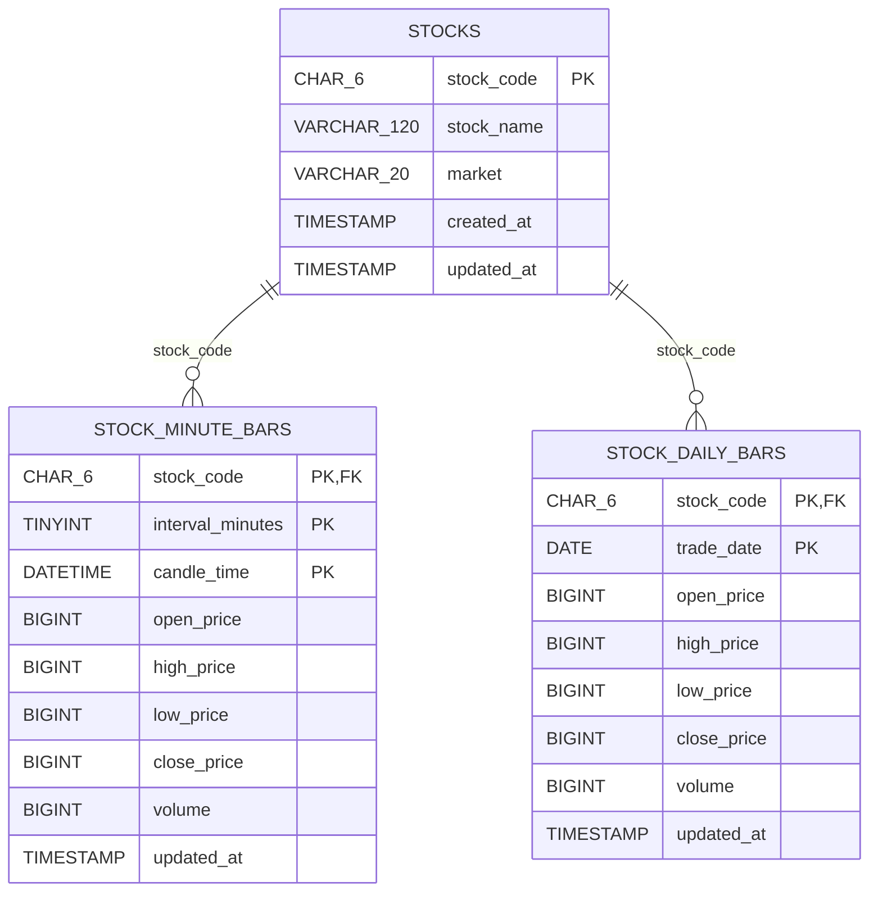

# MySQL ERD (MVP)

`stock_minute_bars`의 복합 PK `(stock_code, interval_minutes, candle_time)`로 종목/분봉단위/시간 중복을 방지하면서 가장 일반적인 최근 N개 캔들 조회를 지원합니다. `stock_daily_bars`는 다음 개발 단계에서 수집 기능을 연결합니다.

시각 저장 기준은 **KST 거래소 현지시각**입니다. 실시간 가격/거래량 및 수정주가 정책은 키움 API의 정책을 따르며, 과거 분봉의 수정주가 재수집 시 UPSERT로 갱신합니다.
